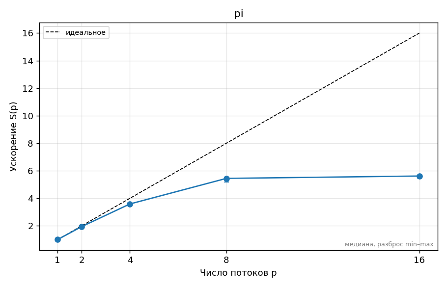

# ДЗ 0. Окружение и паспорт стенда — Евлахов Олег, вариант 4

## 1. Прогноз

ускорение на 2 ядрах ≈ 1.5-2 раза

ускорение на 4 ядрах ≈ 3-4 раза

число физических = числу логических на mac M3.

производительность снизится, время выполнения скорее всего ухудшится.

E-ядра присутствуют. Да, скажется: рост ускорения замедлится.

## 2. Стенд

[Стенд](../SYSTEM.md)

Для этого дз важны P/E ядра. Чётко видно, что ускорение сильно уменьшается при их использовании.

## 3. Методика

Команды: 

make bench THREADS=1,2,4,8,16 N=900000000 REPEAT=5
 

make plots

Корректность проверялась по:

make test

make tsan

make bench THREADS=1,2,4,8,16 N=900000000 (результат одинаковый на разном количестве потоков)

Медиана (получена из pi.csv):

| Threads | Median time (s) |
|---|---|
| 1 | 0.630479 |
| 2 | 0.324041 |
| 4 | 0.175649 |
| 8 | 0.115749 |
| 16 | 0.112222 |

## 4. Результаты

| — | threads=1 | threads=2 | threads=4 | threads=8 | threads=16 |
|---|---|---|---|---|---|
| — | 1.00 | 1.95 | 3.59 | 5.45 | 5.62 |

На графике показано насколько увеличивается скорость выполнения программы в зависимости от числа потоков. Вывод: на 1-4 потоках,  производительных ядрах ускорение увеличивается растет быстрее, чем на энергоэффективных.

## 5. Объяснение расхождений с прогнозом

Прогноз для 2, 4 потоков подтвердился: ускорение составило 1.95, 3.59 соотв. Это связано с тем, потоки выполняются параллельно на 4 ядрах типа P. На 8 потоках ускорение возросло, но меньше, потому что 4 потока выполняются на 4 ядрах P, а остальные - на ядрах меньшей частоты E, ускорение есть, но оно сильно меньше, а на большем числе потоков (точки 8 и 16)- ускорениие минимально. Это происходит, потому что число программных потоков превышает число ядер на устройстве (макс числа потоков), не все потоки можно выполнять параллельно и потоки переходят в режим конкуренции, потоки конкурируют за процессорное время, а также появляются дополнительные расходы на переключение между ними.

## 6. Выводы
1) Система имеет 8 ядер, 4 из которых - производительные (P), 4 - энергоэффективные, более слабые (E)
2) Число логических процессов на машине равно числу физических ядер - особенность архитектуры Mac.
3) Для замеров в следующих заданиях оптимальным числом потоков будет 4 - 8 потоков, так как на них достигается максимальное ускорение. При большем числе потоков ускорение тоже есть, но эффективность кратно меньше, чем при тех же 8.

